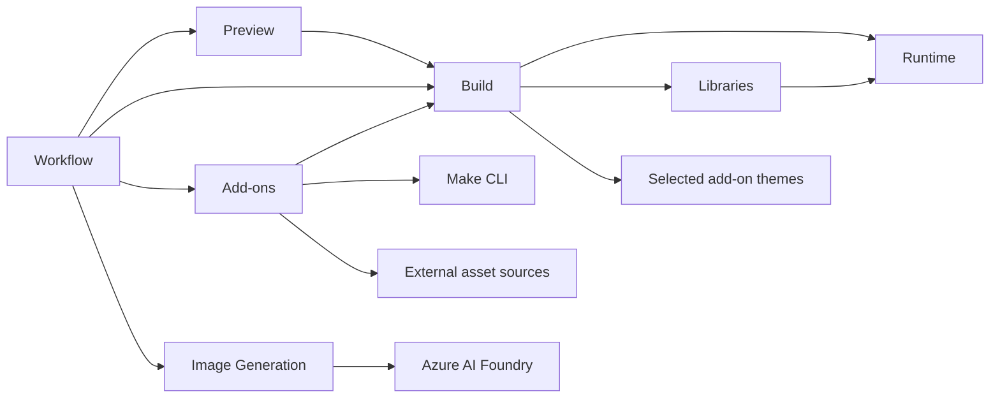
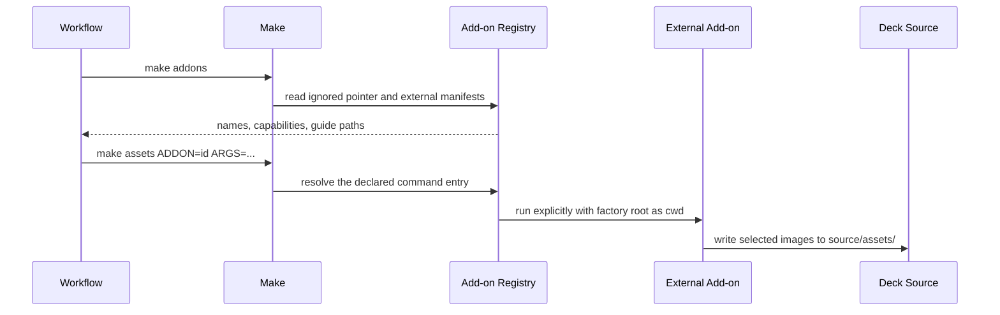
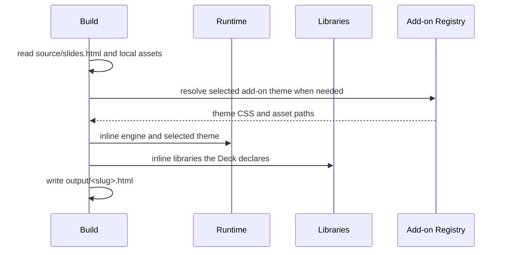

# Codemap

## Overview

Slideware is a factory for single-file HTML slide decks. An agent runs a skill-driven design flow with editable materials under ignored `decks/<slug>/source/`, including slide markup in `source/slides.html`. A Node build writes the self-contained published deck to `decks/<slug>/output/<slug>.html`; optional external add-ons provide local theme files and explicitly invoked asset commands without becoming part of the factory checkout.

### Key Flows

Discovering and using an optional asset source: the agent lists configured add-ons, reads the listed guide, then invokes a selected asset command. The command writes local image files into Deck source; the build inlines them.

Building a deck: the build reads the slides, selects a built-in, checkout-local, or registered add-on theme, inlines images, and assembles the page from the runtime and any declared libraries.

## Modules

### Workflow

The design flow from purpose to review, run as user-invoked skills, plus model-invoked guidance skills (markup, slide rules, storyline, tooling) that the flow and ad-hoc sessions both use.

**Responsibilities:** new-deck entry point and flow, dialog conventions, purpose, audience, structure, storyboard, content writing, review, slide markup reference, local add-on discovery and use, live preview launch

**Dependencies:** Build (writes slides the build consumes), Preview (launched by the content step), Add-ons (optional source catalog and asset commands). Reverse: none.

**Files:**
- `.agents/skills/**`

### Add-ons

Resolves paths from ignored `.local/slideware.json` to external, declarative `slideware-addon.json` manifests. It never loads add-on code during discovery or builds; asset commands run only when explicitly selected.

**Responsibilities:** config and manifest validation, external path containment, theme and command discovery, collision errors, agent-readable capability listing, explicit command dispatch

**Dependencies:** external filesystem paths for manifests and theme files; child Node processes for explicitly invoked commands. Reverse: Build resolves selected themes; Make exposes listing and command dispatch; Workflow reads the catalog.

**Files:**
- `addons/**`
- `.local/slideware.json` (checkout-local pointer, ignored by Git)
- External add-on directories configured by that pointer (not tracked)

### Image Generation

Optional FLUX.2 image generation through an Azure AI Foundry endpoint configured for the current checkout.

**Responsibilities:** image-model registration and image request/response adaptation; registers no model unless both endpoint and key are configured

**Dependencies:** Azure AI Foundry (external, paid API; used only on request). Reverse: Workflow's deck-images skill may invoke it.

**Files:**
- `.pi/extensions/**`

### Build

Assembles `output/<slug>.html` from `source/slides.html` and `source/assets/`: header parsing, built-in/local/add-on theme selection, the shell, image inlining, and the rules the published deck must satisfy.

**Responsibilities:** slide title/theme/library headers, shell assembly, engine-block layout matching deckfile's update rule, built-in/local/add-on theme selection, image inlining and size warnings, remote-resource warnings, build tests

**Dependencies:** Runtime (engine and selected theme inlined into every Deck), Libraries (inlined when declared), Add-ons (resolves selected external theme CSS/assets), Preview (shares the render path and watches selected theme dependencies). Reverse: Preview, Workflow.

**Files:**
- `build/**`
- `themes/**` (built-in themes)
- `.local/themes/**` (checkout-local themes, ignored by Git)

### Preview

Live preview for the content and review steps: rebuilds on each change and reloads the open page. Dev-only, never in shipped output.

**Responsibilities:** polling for slide, image, and selected theme changes; rebuilding with the dev reload hook; keeping the last good build on a failed save; HTTP serving on localhost

**Dependencies:** Build (renders each version and reports the dependencies to watch). Reverse: Workflow launches it.

**Files:**
- `preview/**`

### Runtime

The presentation engine and built-in theme every Deck carries: placing, scaling, builds, presenter and edit views, print.

**Responsibilities:** slide stage at 1920×1080, keys and builds, presenter view, edit view (writes over the built file, not the source), print to PDF, theme tokens and slide classes

**Dependencies:** none. Reverse: Build inlines it; Libraries reads its theme tokens.

**Files:**
- `engine/**`
- `themes/**`
- `.local/themes/**` (checkout-local CSS themes, ignored by Git)

### Libraries

Vendored optional libraries (Chart.js, Tabulator, Mermaid Tiny) and the glue that starts them in their Deck theme colours and sizes.

**Responsibilities:** vendored builds with licences, library manifest (`chart`, `tabulator`, `mermaid`), chart and table initialisation/redraw, eager offscreen Mermaid SVG rendering after fonts settle, diagram readiness/error states, slide-sized layout overrides

**Dependencies:** Runtime (reads theme tokens such as `--accent` and `--muted`). Reverse: Build inlines them when a Deck declares them.

**Files:**
- `libs/**`

### Records

Project instructions, update/customization contract, decision records, and research behind the stack.

**Responsibilities:** upstream-versus-local ownership, external add-on contract, project vision and rules, DR-001 to DR-007, stack research

**Dependencies:** none. Reverse: every module's design rests on these records.

**Files:**
- `AGENTS.md`
- `.gitignore`
- `.env.example`
- `LICENSE`
- `docs/customization.md`
- `docs/decisions/**`
- `research/**`
